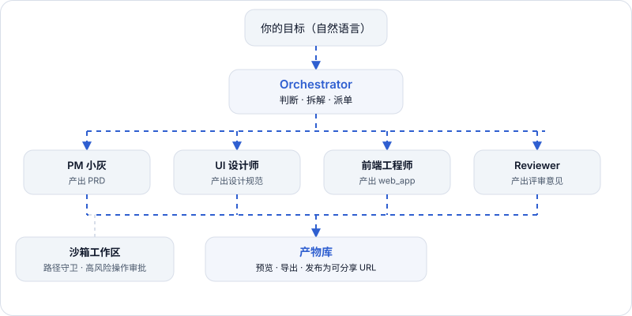

# Multi-Agent TeamFlow

<p align="center">
  
  
  
  
  
  
  
</p>

<p align="center">
  <b>English</b> · <a href="./README.zh-CN.md">简体中文</a>
</p>

## One-line positioning

> **A local-first, multi-agent workspace — you give it one sentence of intent, it hands back one deliverable.**

Instead of juggling one prompt window per task, you get a group chat: a dispatcher agent breaks your goal into subtasks, assigns them to specialist agents, and collects their deliverables as first-class objects you can preview, keep, and reuse. Everything — conversations, agents, artifacts, approvals, workspace files, and the SQLite database — lives on your own machine. **No account, no cloud round-trip.**

> **Current release: v0.2.0-rc.1** — see [`VERSION`](./VERSION) and [`CHANGELOG.md`](./CHANGELOG.md).

---

## Key features

- **Orchestrator-driven dispatch.** The built-in `Orchestrator` reads your goal, decides whether the task genuinely needs multiple roles, and uses `plan_tasks` to split and assign work. Simple questions get answered directly — it is instructed *not* to over-dispatch.
- **Group chats.** A conversation can hold any number of agents; you `@` them or let the orchestrator route.
- **Artifacts as first-class objects.** `web_app` · `document` · `image` · `ppt` · `diagram` · `code_file` · `diff` · `project` are all previewable and exportable, and each records the prompt, model, and parameters that produced it, so results are reproducible.
- **Artifact dependency chains.** The typical flow is `PRD → design guide → web_app → review`; downstream agents read upstream artifacts rather than re-deriving context from prose.
- **5 built-in agents, infinitely extensible.** Orchestrator · PM 小灰 · UI 设计师 · 前端工程师 · Reviewer (all on `claude-code`), plus a builder for custom adapters, models, tools, and prompts.
- **A real terminal, with approvals.** `bash` is a real `node-pty` terminal, gated by a command deny-list, an outbound-network guard, and **approval prompts before execution** — nothing runs until you approve.
- **Pluggable adapters.** `claude-code` · `codex` · `custom-agent` (any OpenAI-compatible endpoint) · `image-gen` · `mock`.
- **Three clients, one dataset.** Web (Next.js App Router), Desktop (a thin Electron 33 shell), and Mobile companion (Capacitor, device-token gated).

---

## Visual preview

### App screenshot

<p align="center">
  
</p>

> Image not loading? This screenshot is a static asset inside the repository — open [`docs/images/teamflow-preview.png`](./docs/images/teamflow-preview.png) directly, or download the desktop app to see the real UI.

### Architecture and flow

<p align="center">
  
</p>

> Image not loading? The diagram is a static SVG asset in the repository — open [`docs/images/architecture.svg`](./docs/images/architecture.svg) directly. The trunk is: **goal → Orchestrator dispatch → specialist agents produce typed artifacts → collected into the artifact library**. Everything runs on your machine; file access is confined by a path guard, and risky commands need your approval.

---

## Quickstart

```bash
# 1. Clone
git clone https://github.com/Composure666/Multi-Agent-TeamFlow.git multi-agent-teamflow
cd multi-agent-teamflow

# 2. Install dependencies (packageManager pins pnpm@11.9.0; Corepack resolves it)
pnpm install

# 3. Create your local env file and fill in at least one provider API key (never committed)
cp .env.example .env.local

# 4. Start
pnpm dev
```

Open <http://localhost:3000>. On first launch the app creates the SQLite database under `.agenthub-data/` and seeds the 5 built-in agents automatically. No manual migration step is needed.

Desktop and mobile companion:

```bash
pnpm electron:dev     # desktop development (Next dev server + Electron window)
pnpm electron:build   # package an installer → release/
pnpm mobile:sync      # build web assets and copy them into the native projects
pnpm mobile:open:ios  # or mobile:open:android
```

> Want to look before you leap? The project homepage (`/home`) is the public guest surface — after starting locally, visit `http://localhost:3000/home` for screenshots, the architecture diagram, and the full introduction.

---

## FAQ

**Q: Do I need an account? Does my data go to the cloud?**
A: Neither. It is a local-first, single-tenant app — there is no concept of an "account". Conversations, artifacts, approvals, and the SQLite database all stay on your machine, with no cloud round-trip.

**Q: Do I need my own model API key? Which providers are supported?**
A: Yes — keys are bring-your-own (set them in `.env.local` or under **Settings → Providers**; they are masked in API responses). DeepSeek, Anthropic Claude, OpenAI and any OpenAI-compatible endpoint, Volcano Ark, and more are supported. If a provider starts failing, the dispatcher walks a configured priority list instead of dying on the first error.

**Q: How is this different from a normal single chat window?**
A: In a normal window you do the splitting and the hand-offs yourself. Here the `Orchestrator` decides whether multiple roles are actually needed, writes down the responsible agent and expected artifact, and dispatches; downstream agents read upstream artifacts instead of re-guessing context from the conversation.

**Q: Will the Orchestrator over-dispatch a simple question into a swarm of tasks?**
A: No. Its prompt explicitly requires judging whether the task genuinely needs multiple roles first; when it does not, it answers directly.

**Q: Can agents really run commands and write files? Is that safe?**
A: Yes — `bash` is a real `node-pty` terminal. Four constraints apply: a command deny-list, an outbound-network guard (blocks cloud-metadata endpoints, private ranges, and the platform's own loopback ports), a workspace path guard (symlinks resolved before the boundary check), and **approval prompts before risky operations**. Nothing executes until you approve.

**Q: What exactly is an artifact? Can I export or share it?**
A: An artifact is not chat text — it is a typed, previewable, exportable record in the artifact library (`web_app` / `document` / `image` / `ppt` / `diagram` / `code_file` / `diff` / `project`) that records the prompt, model, and parameters used to produce it. A single artifact or a whole workspace can be published to a shareable URL.

**Q: Do desktop, web, and mobile share the same data?**
A: Desktop and web are the same app with a different shell — the data location is decided by who runs the Node process, and the database is the same single SQLite file. The mobile app is a Capacitor companion that connects over your LAN or a Tailscale netlist, gated by a device token.

**Q: What is the license, and what are my obligations?**
A: AGPL-3.0-only. If you let others interact with it over a network, AGPL-3.0 section 13 requires you to offer the Corresponding Source. This project is also a derivative work of upstream `lizyoko9/bitdance-agenthub`; see [`NOTICE.md`](./NOTICE.md) for attribution and the itemized list of changes.

---

## Going deeper

### Tech stack

| Layer | Choice |
|---|---|
| Framework | Next.js 16 (App Router) |
| UI | React 19, Tailwind CSS v4, shadcn/ui |
| State | Zustand + Immer |
| Database | SQLite via Drizzle ORM + better-sqlite3 |
| Live updates | Server-Sent Events (SSE) |
| Desktop | Electron 33 |
| Mobile | Capacitor |
| Language | TypeScript (strict) |
| Monorepo | pnpm workspaces |

### Requirements

- **Node.js 20+** (Node 24 is what the test suite is exercised against)
- **pnpm** — the `packageManager` field pins `pnpm@11.9.0`, so Corepack resolves the right version automatically
- **Git**
- macOS or Windows for Electron development and packaging
- Xcode + CocoaPods only if you work on the iOS companion app

### Environment variables

All configuration lives in `.env.local` (never committed). Copy from [`.env.example`](./.env.example).

**Provider API keys** — fill in at least one:

| Variable | Notes |
|---|---|
| `DEEPSEEK_API_KEY` | Primary provider in the default setup |
| `ANTHROPIC_API_KEY` | Claude models |
| `OPENAI_API_KEY` | OpenAI and OpenAI-compatible endpoints |
| `ARK_API_KEY` | Volcano Ark (required for Doubao multimodal models) |
| `ANTHROPIC_BASE_URL` | Optional; override the Anthropic endpoint (e.g. a gateway) |

**Optional:**

| Variable | Notes |
|---|---|
| `OSS_BUCKET` / `OSS_ENDPOINT` / `OSS_ACCESS_KEY_ID` / `OSS_ACCESS_KEY_SECRET` | Aliyun OSS for durable image-artifact storage. **All four must be set** or images fall back to local storage (and break after a container rebuild). |
| `PROMPT_OPTIMIZE_MODEL` | `deepseek-v4-flash` or `deepseek-v4-pro` |
| `PROMPT_OPTIMIZE_{ANTHROPIC,OPENAI,ARK}_MODEL` | Per-provider override |
| `GITHUB_TOKEN` / `GH_TOKEN` | Raises the rate limit for GitHub tool search |
| `NEXT_TELEMETRY_DISABLED` | Set to `1` in CI |
| `AGENTHUB_DATA_DIR` | Where the database and workspace live. Set this for containerised deployments — the default is the current working directory. |
| `AGENTHUB_MOBILE_TOKEN` | Device token for the mobile companion app |

**Managed at runtime — do not set by hand:** `PORT`, `AGENTHUB_DEV`, `AGENTHUB_COMPANION_MODE`, `AGENTHUB_MOBILE_ALLOWED_ORIGINS`, `AGENTHUB_INTERNAL_BASE_URL`, `AGENTHUB_ALLOWED_TOOLS`, `ELECTRON_RUN_AS_NODE`, `CODEX_API_KEY`, `MCP_SERVICE_TEST_TOKEN`.

> Most settings can also be edited in the UI (**Settings → Providers**). The app stores provider keys in the local database. They are **masked** in API responses and only written back when you actually edit the field.

**Deprecated:** `ORCHESTRATOR_PROVIDER` / `ORCHESTRATOR_MODEL_ID` are no longer read anywhere. The orchestrator takes its model from the agent row itself.

### Files that must stay out of Git

- `.env.local` and any other `.env*` file (`.gitignore` already covers these)
- `*.pem`, `*.key`, `id_rsa*`, `.netrc`, credentials JSON files
- `.agenthub-data/` — the SQLite database and local workspace
- `release/`, `dist-electron/`, `.next/`

### Shared configuration (these *do* belong in Git)

`package.json` · `next.config.ts` · `drizzle.config.ts` · `eslint.config.mjs` · `vitest.config.ts` · `playwright.config.ts` · `src/db/schema.ts` · `src/db/builtin-agents.ts` · `.env.example`

`src/db/builtin-agents.ts` is the single source of truth for the default agents, their prompts, tools, and capabilities. It is consumed both by `pnpm db:seed` (development) and by the packaged app's first-launch bootstrap.

### Agent tools

`bash` · `fs_list` · `fs_read` · `fs_write` · `read_artifact` · `write_artifact` · `read_attachment` · `plan_tasks` · `ask_user` · `web_fetch` · `deploy_artifact` · `deploy_workspace` · `failing_result`

Adding an adapter is a documented process — see [`skills/add-adapter.md`](./skills/add-adapter.md).

### Common commands

```bash
# Development
pnpm dev                  # Next.js dev server
pnpm electron:dev         # desktop dev (also runs the Next dev server)
pnpm mobile:dev           # mobile companion dev

# Quality
pnpm lint                 # ESLint
pnpm typecheck            # tsc --noEmit
pnpm test                 # vitest
pnpm test:watch           # vitest in watch mode
pnpm e2e                  # Playwright
pnpm e2e:ui               # Playwright UI mode

# Build & package
pnpm build                # production build
pnpm start                # run the production build
pnpm electron:build       # package a desktop installer → release/
pnpm mobile:build         # build mobile web assets

# Database
pnpm db:generate          # generate Drizzle migrations
pnpm db:push              # push schema to the SQLite database
pnpm db:seed              # seed built-in agents
pnpm db:studio            # Drizzle Studio
```

> **Note on running tests:** use a Node version whose ABI matches the installed `better-sqlite3` binary. If you hit `NODE_MODULE_VERSION` mismatch errors, run `pnpm sqlite:ensure:node` (which `pnpm test` already does) or `pnpm electron:rebuild`.

### Repository layout

```
src/
  app/            Next.js routes and API endpoints
  components/     UI components and workbench screens
  server/         Services, adapters, tools, sandbox and network guards
    adapters/     claude-code · codex · custom-agent · image-gen · mock
    tools/        bash, fs_*, artifact, plan_tasks, web_fetch, deploy_*
  db/             SQLite schema, bootstrap/migrations, built-in agent seed
  lib/            Client-side helpers and API bindings
  shared/         Types and constants shared by client and server
  stores/         Zustand stores
  types/          Ambient type declarations

electron/         Electron main process, preload, companion proxy
apps/mobile/      Capacitor companion app (iOS / Android)
skills/           Skill bundles + authoring guides (add a tool, adapter, …)
specs/            Numbered technical specifications
openspec/         Capability contracts and change proposals
docs/             Deployment and environment documentation
deploy/           Self-hosting scripts, nginx config, runbook
e2e/              Playwright end-to-end tests
public/           Static assets
```

### Contributing

> Full guidelines live in [`CONTRIBUTING.md`](./CONTRIBUTING.md) (environment constraints and known pitfalls); security matters are covered in [`SECURITY.md`](./SECURITY.md).

1. Branch for your change; keep each branch focused on one task.
2. Update specs or docs when behavior changes.
3. Run `pnpm typecheck`, `pnpm lint`, and `pnpm test` before opening a PR.
4. **Never commit `.env.local`, API keys, or database files.** If you add a new non-secret setting, document it in `.env.example` and here.
5. Do not hardcode real resource identifiers (bucket names, hostnames, IPs) in tests, comments, or docs — use obvious placeholders like `test-bucket` and `oss-cn-hangzhou.aliyuncs.com`.

### Documentation

| File | Contents |
|---|---|
| [`INSTALL.md`](./INSTALL.md) | Step-by-step setup |
| [`OVERVIEW.md`](./OVERVIEW.md) | Code map and implementation status |
| [`CLAUDE.md`](./CLAUDE.md) | Project conventions for AI-assisted work |
| [`docs/deployment-env.md`](./docs/deployment-env.md) | Environment variable reference |
| [`deploy/RUNBOOK.md`](./deploy/RUNBOOK.md) | Self-hosting runbook |
| [`specs/`](./specs/) | Numbered technical specs |
| [`openspec/`](./openspec/) | Capability contracts |
| [`CHANGELOG.md`](./CHANGELOG.md) | Release history |
| [`NOTICE.md`](./NOTICE.md) | License and attribution notice |
| [`CONTRIBUTING.md`](./CONTRIBUTING.md) | Contribution guide (environment constraints and known pitfalls) |
| [`SECURITY.md`](./SECURITY.md) | Security policy and self-hosting risk notes |

---

## License and attribution

Copyright (C) 2026 Multi-Agent TeamFlow contributors.

This program is free software: you can redistribute it and/or modify it under the terms of the **GNU Affero General Public License v3.0** (`AGPL-3.0-only`) as published by the Free Software Foundation. See [`LICENSE`](./LICENSE).

This project is a **derivative work (modified version)** of [`lizyoko9/bitdance-agenthub`](https://github.com/lizyoko9/bitdance-agenthub), which is also licensed under AGPL-3.0. Under AGPL-3.0 section 5, the combined work must remain under AGPL-3.0 — it cannot be relicensed under more permissive or proprietary terms.

Upstream copyright notices, the statement of modification, and the itemized list of changes are recorded in [`NOTICE.md`](./NOTICE.md).

**AGPL-3.0 section 13:** if you interact with this software over a network, you are entitled to obtain its Corresponding Source. [`NOTICE.md`](./NOTICE.md) states where to obtain it.

This program is distributed in the hope that it will be useful, but **WITHOUT ANY WARRANTY**; without even the implied warranty of MERCHANTABILITY or FITNESS FOR A PARTICULAR PURPOSE.
