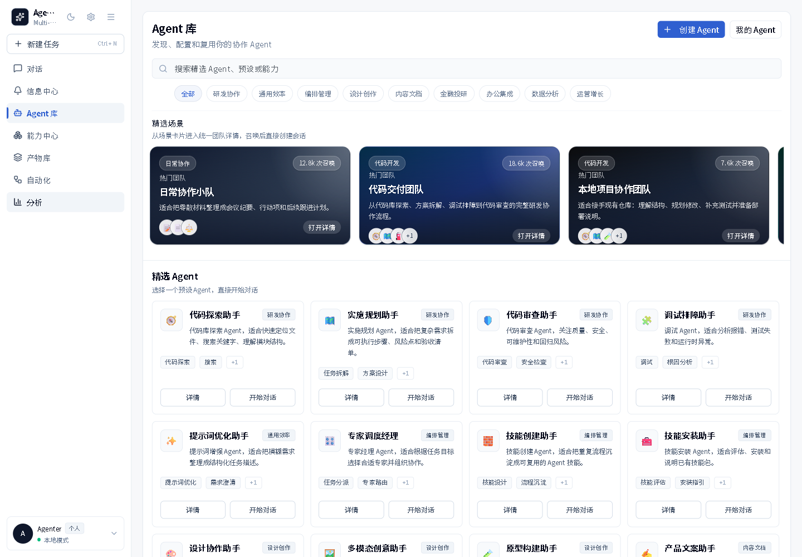

# AgentHub

<p align="center">
  
  
  
  
  
  
</p>

<p align="center">
  <b>English</b> · <a href="./README.zh-CN.md">简体中文</a>
</p>

AgentHub is a local-first multi-agent workspace for IM-style AI collaboration.

It keeps conversations, agents, artifacts, approvals, and workspace files in one place so you can manage real work instead of juggling separate prompts and terminals.

<p align="center">
  
</p>

> **Current release: v0.2.0-rc.1** (2026-09-12) — first ship-candidate after security audit & QA pass.
> See [`VERSION`](./VERSION) and [`CHANGELOG.md`](./CHANGELOG.md) for what's new.

## What it does

- Chat-style workspaces for single-agent and group-agent conversations
- Built-in Orchestrator for task planning and multi-agent dispatch
- Structured messages with parts for text, thinking, tool calls, attachments, and artifact refs
- Artifact previews for documents, images, web apps, slides, diffs, and code files
- Workspace sandboxing with approval flow for risky file writes and commands
- Desktop app support through Electron
- Mobile companion app scaffold through Capacitor

## Tech stack

- Next.js 16 App Router
- React 19
- TypeScript strict mode
- Tailwind CSS v4 + shadcn/ui
- Zustand + Immer
- SQLite + Drizzle + better-sqlite3
- SSE for live updates
- Electron 33
- Capacitor
- pnpm workspaces

## Requirements

- Node.js 20+
- pnpm
- Git
- macOS or Windows for Electron development and packaging
- Xcode and CocoaPods only if you work on the iOS companion app

## Quick start

```bash
pnpm install
cp .env.example .env.local
pnpm dev
```

Open <http://localhost:3000>.

The first launch creates the SQLite database and seeds the built-in agents automatically.

## Configuration

### Shared, versioned configuration

These files belong in Git because they define shared project behavior:

- `package.json`
- `next.config.ts`
- `drizzle.config.ts`
- `eslint.config.mjs`
- `vitest.config.ts`
- `playwright.config.ts`
- `src/db/builtin-agents.ts`
- `src/db/schema.ts`
- `.env.example`

The built-in Agent library lives in `src/db/builtin-agents.ts`. That is the shared source for default agents, prompts, tools, and capabilities.

### Local private configuration

Keep these out of Git:

- `.env.local`
- SQLite database files under `.agenthub-data/`
- local workspace data
- app settings values that contain API keys or tokens

Typical private values include:

- `ANTHROPIC_API_KEY`
- `OPENAI_API_KEY`
- `DEEPSEEK_API_KEY`
- `ARK_API_KEY`
- `ANTHROPIC_BASE_URL`
- `AGENTHUB_MOBILE_TOKEN`

If you need to share a new non-secret setting with the team, add it to `.env.example` and document it here or in `INSTALL.md`.

## Running the app

### Web development

```bash
pnpm dev
```

### Electron desktop development

```bash
pnpm electron:dev
```

### Production build

```bash
pnpm build
pnpm start
```

### Desktop packaging

```bash
pnpm electron:build
```

Build output is written to `release/`.

## Common commands

```bash
pnpm dev
pnpm build
pnpm start
pnpm lint
pnpm typecheck
pnpm test
pnpm e2e
pnpm db:push
pnpm db:seed
pnpm electron:dev
pnpm electron:build
pnpm mobile:dev
pnpm mobile:build
```

## Repository layout

- `src/app/` — Next.js routes and API routes
- `src/components/` — UI components and workbench screens
- `src/server/` — application services, adapters, and tool execution
- `src/db/` — SQLite schema, seed data, and bootstrap logic
- `src/shared/` — shared types and constants
- `apps/mobile/` — Capacitor mobile companion app
- `electron/` — Electron main process and bootstrap code
- `specs/` and `openspec/` — project specs and capability contracts

## Contributing

1. Create a branch for the change.
2. Keep the change focused on one task.
3. Update docs or specs when behavior changes.
4. Run `pnpm typecheck` and `pnpm lint` before opening a PR.
5. Do not commit `.env.local`, API keys, or local databases.

## More docs

- `INSTALL.md` — step-by-step setup guide
- `README.zh-CN.md` — Chinese project overview
- `OVERVIEW.md` — code map and current implementation status
- `CLAUDE.md` — project rules for AI-assisted work
- `docs/AI-COLLABORATION.md` — collaboration notes and workflow
- `specs/` — numbered technical specs
