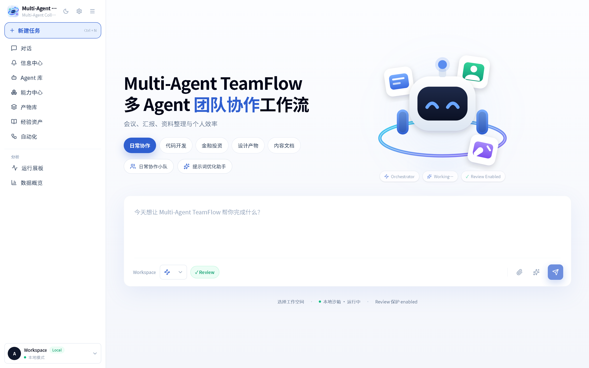

# Multi-Agent TeamFlow

<p align="center">
  
  
  
  
  
  
  
</p>

<p align="center">
  <a href="./README.md">English</a> · <b>简体中文</b>
</p>

Multi-Agent TeamFlow 是一个**本地优先的多 Agent 协作工作空间**，把 AI 协作做成类似 IM 群聊的体验。你不必为每个任务单独开一个提示词窗口：这里有一个「调度 Agent」负责把目标拆成子任务、派发给不同专长的 Agent，再把它们的交付物收拢成一等公民对象 —— 可预览、可留存、可复用。

所有东西 —— 会话、Agent、产物、审批记录、工作区文件、SQLite 数据库 —— 都在你自己的机器上。无需注册账号，也不经过任何云端中转。

<p align="center">
  
</p>

> **当前版本：v0.2.0-rc.1** —— 版本号与变更明细见 [`VERSION`](./VERSION) 与 [`CHANGELOG.md`](./CHANGELOG.md)。

---

## 功能特性

### 多 Agent 协作

- **Orchestrator 驱动派单。** 内置的 `Orchestrator` 会读懂你的目标，先判断这件事是否真的需要多个角色，再用 `plan_tasks` 工具拆分与派发。简单问题直接回答 —— 它的提示词里明确要求**不要过度派单**。
- **群聊式会话。** 一个会话里可以放任意多个 Agent，既可以自己 `@` 指定，也可以交给 Orchestrator 路由。
- **产物依赖链。** 典型链路是 `PRD → 设计规范 → web_app → 评审`，下游 Agent 直接读上游产物，而不是从自然语言里重新猜上下文。
- **降级链。** 某个 provider 开始报错时，调度器会沿配置好的 provider 优先级依次尝试，而不是在第一个错误上直接失败。

### 内置 5 个 Agent（全部走 `claude-code` 适配器）

| Agent | 职责 |
|---|---|
| 🎯 **Orchestrator** | 理解意图、拆解任务、派单、聚合成品 |
| 📋 **PM 小灰** | 需求分析、用户故事、PRD |
| 🎨 **UI 设计师** | UI 风格指南与设计规范 |
| 💻 **前端工程师** | 前端实现，产出 `web_app` 产物 |
| 🔍 **Reviewer** | 对照原始需求评审交付物 |

你也可以用 Agent 构建器创建自己的 Agent（可选适配器、模型、工具、system prompt 与能力开关）。

### 产物是一等公民

交付物不是聊天里的一段文字，而是产物库里带类型、可预览的记录：

`web_app` · `document` · `image` · `ppt` · `diagram` · `code_file` · `diff` · `project`

每条产物都记录了生成它所用的 prompt、模型和参数，因此结果可复现。一次运行产出多张图片时，会自动归入同一个相册。

### 工作区沙箱与审批

- 两种工作区模式：**沙箱**（由应用托管的目录）与 **本地**（绑定你自己指定的目录）。
- 所有文件访问都经过路径守卫，会解析符号链接并拒绝越出工作区根目录的路径。
- **bash 是真实终端**（`node-pty`），外面套了命令黑名单、出网守卫（拦截云元数据端点、内网网段、以及平台自身的回环端口）和高风险操作的审批流。
- 破坏性命令或文件写入执行前，UI 里会弹出**审批提示**。

### Agent 可用工具

`bash` · `fs_list` · `fs_read` · `fs_write` · `read_artifact` · `write_artifact` · `read_attachment` · `plan_tasks` · `ask_user` · `web_fetch` · `deploy_artifact` · `deploy_workspace` · `failing_result`

### 可插拔适配器

| 适配器 | 用途 |
|---|---|
| `claude-code` | Claude Agent SDK —— 内置 Agent 的默认选择 |
| `codex` | Codex 风格执行，配合平台工具白名单 |
| `custom-agent` | 任何 OpenAI 兼容的 chat 端点（DeepSeek、火山方舟、OpenAI、自建网关） |
| `image-gen` | OpenAI 兼容的 `/images/generations` |
| `mock` | 确定性桩实现，用于测试与离线演示 |

新增适配器有文档化流程 —— 见 [`skills/add-adapter.md`](./skills/add-adapter.md)。

### Skills、经验与自动化

- **Skills** —— 可复用的提示词/能力包（`skills/`），并附有「新增工具 / 产物类型 / 消息分片 / 适配器 / 经验条目」的写作指南。
- **经验（Experience）** —— 平台会从已完成的运行中提炼可复用教训，并注入到后续提示词里。
- **自动化（Automations）** —— 定时任务，结果会以通知形式回到会话中。
- **产物发布** —— 可将单个产物或整个工作区部署出去，拿到一个可分享的 URL。

### 多客户端

- **Web** —— 主界面（Next.js App Router）
- **桌面端** —— 极薄的 Electron 外壳，指向同一个本地服务；可选系统通知
- **移动端** —— Capacitor 伴随应用，通过局域网或 Tailscale 网络连接，由设备 token 鉴权

---

## 技术栈

| 层次 | 选型 |
|---|---|
| 框架 | Next.js 16（App Router） |
| UI | React 19、Tailwind CSS v4、shadcn/ui |
| 状态 | Zustand + Immer |
| 数据库 | SQLite via Drizzle ORM + better-sqlite3 |
| 实时推送 | Server-Sent Events（SSE） |
| 桌面端 | Electron 33 |
| 移动端 | Capacitor |
| 语言 | TypeScript（strict） |
| 仓库形态 | pnpm workspaces |

---

## 环境要求

- **Node.js 20+**（测试套件实测跑在 Node 24 上）
- **pnpm** —— `packageManager` 字段已固定为 `pnpm@11.9.0`，Corepack 会自动取到正确版本
- **Git**
- 桌面端开发与打包需要 macOS 或 Windows
- 仅当你要开发 iOS 伴随端时才需要 Xcode + CocoaPods

---

## 安装

```bash
# 1. 克隆
git clone https://gitee.com/Composure666/Multi-Agent-TeamFlow.git multi-agent-teamflow
cd multi-agent-teamflow

# 2. 安装依赖
pnpm install

# 3. 生成本机环境变量文件
cp .env.example .env.local
#    然后编辑 .env.local，至少填入一个 provider 的 API key

# 4. 启动
pnpm dev
```

打开 <http://localhost:3000>。

首次启动时，应用会在 `.agenthub-data/` 下自动创建 SQLite 数据库并 seed 上述 5 个内置 Agent，无需手动执行迁移。

### 桌面端

```bash
pnpm electron:dev     # 开发模式（Next dev server + Electron 窗口）
pnpm electron:build   # 打包安装包 → release/
```

### 移动伴随端

```bash
pnpm mobile:sync          # 构建 Web 资源并拷贝进原生工程
pnpm mobile:open:ios      # 或 mobile:open:android
```

---

## 配置

### 环境变量

所有配置都放在 `.env.local`（绝不提交）。从 [`.env.example`](./.env.example) 复制。

**Provider API key** —— 至少填一个：

| 变量 | 说明 |
|---|---|
| `DEEPSEEK_API_KEY` | 默认配置下的主 provider |
| `ANTHROPIC_API_KEY` | Claude 系列模型 |
| `OPENAI_API_KEY` | OpenAI 及 OpenAI 兼容端点 |
| `ARK_API_KEY` | 火山方舟（使用豆包多模态模型时必需） |
| `ANTHROPIC_BASE_URL` | 可选；覆盖 Anthropic 端点（例如指向网关） |

**可选：**

| 变量 | 说明 |
|---|---|
| `OSS_BUCKET` / `OSS_ENDPOINT` / `OSS_ACCESS_KEY_ID` / `OSS_ACCESS_KEY_SECRET` | 阿里云 OSS，用于图片产物的持久化存储。**四个必须同时设置**，否则图片回落到本地存储（容器重建后就丢了）。 |
| `PROMPT_OPTIMIZE_MODEL` | `deepseek-v4-flash` 或 `deepseek-v4-pro` |
| `PROMPT_OPTIMIZE_{ANTHROPIC,OPENAI,ARK}_MODEL` | 按 provider 覆盖 |
| `GITHUB_TOKEN` / `GH_TOKEN` | 提高 GitHub 工具搜索的速率上限 |
| `NEXT_TELEMETRY_DISABLED` | CI 中设为 `1` |
| `AGENTHUB_DATA_DIR` | 数据库与工作区的存放位置。容器化部署必须设置 —— 默认值是当前工作目录。 |
| `AGENTHUB_MOBILE_TOKEN` | 移动伴随端的设备 token |

**运行时自动管理 —— 不要手工设置：** `PORT`、`AGENTHUB_DEV`、`AGENTHUB_COMPANION_MODE`、`AGENTHUB_MOBILE_ALLOWED_ORIGINS`、`AGENTHUB_INTERNAL_BASE_URL`、`AGENTHUB_ALLOWED_TOOLS`、`ELECTRON_RUN_AS_NODE`、`CODEX_API_KEY`、`MCP_SERVICE_TEST_TOKEN`。

> 大部分设置也可以在界面里改（**设置 → 供应商**）。provider key 存在本地数据库里，API 返回时会**脱敏**，且只有在你真的改动了该字段时才会被写回。

**已废弃：** `ORCHESTRATOR_PROVIDER` / `ORCHESTRATOR_MODEL_ID` 已不再被任何代码读取。Orchestrator 的模型取自它自己的 Agent 记录。

### 必须排除在 Git 之外的文件

- `.env.local` 及其他 `.env*` 文件（`.gitignore` 已覆盖）
- `*.pem`、`*.key`、`id_rsa*`、`.netrc`、各类凭据 JSON
- `.agenthub-data/` —— SQLite 数据库与本地工作区
- `release/`、`dist-electron/`、`.next/`

### 共享配置（这些**应该**纳入 Git）

`package.json` · `next.config.ts` · `drizzle.config.ts` · `eslint.config.mjs` · `vitest.config.ts` · `playwright.config.ts` · `src/db/schema.ts` · `src/db/builtin-agents.ts` · `.env.example`

`src/db/builtin-agents.ts` 是默认 Agent 的唯一真源：名称、描述、system prompt、工具、能力都从这里 seed，开发期的 `pnpm db:seed` 和打包后应用的首次启动引导都会消费它。

---

## 使用说明

### 单 Agent 会话

新建任务，`@` 一个 Agent，说明你要什么。Agent 会开始运行、按需调用工具，最后返回答案以及它产出的产物。

### 多 Agent 协作

`@` **Orchestrator**（或直接开一个群聊让它自行路由）。它会调用 `plan_tasks`，该工具会：

1. 判断这件事是否真的需要多个 Agent；
2. 写出计划：指定责任 Agent、预期产物、以及依赖关系；
3. 派单 —— 下游 Agent 会自动读到上游产物。

一次典型的端到端运行：

```
你：做一个咖啡订阅服务的落地页
  → Orchestrator 制定计划
  → PM 小灰      产出 PRD（document）
  → UI 设计师    产出风格指南（document），读取 PRD
  → 前端工程师   产出 web_app 产物，读取前两者
  → Reviewer     对照 PRD 评审 web_app
```

### 产物

在侧边栏打开 **产物**。每条记录都能就地预览（渲染后的 HTML、图片、幻灯片、diff 或源码文件），并附有生成它所用的 prompt / 模型 / 参数。

### 审批

当 Agent 想执行高风险 shell 命令、或想写到预期范围之外时，会话里会弹出审批提示。在你批准之前，什么都不会真的执行。

### 工作区

每个会话可以单独选择工作区：

- **沙箱** —— 由应用自己管理的目录
- **本地** —— 绑定一个你已有的目录

所有文件操作都被限制在工作区根目录内，边界检查之前会先解析符号链接。

---

## 常用命令

```bash
# 开发
pnpm dev                  # Next.js 开发服务
pnpm electron:dev         # 桌面端开发（同时会起 Next dev server）
pnpm mobile:dev           # 移动伴随端开发

# 质量
pnpm lint                 # ESLint
pnpm typecheck            # tsc --noEmit
pnpm test                 # vitest
pnpm test:watch           # vitest watch 模式
pnpm e2e                  # Playwright
pnpm e2e:ui               # Playwright UI 模式

# 构建与打包
pnpm build                # 生产构建
pnpm start                # 运行生产构建
pnpm electron:build       # 打包桌面安装包 → release/
pnpm mobile:build         # 构建移动端 Web 资源

# 数据库
pnpm db:generate          # 生成 Drizzle 迁移
pnpm db:push              # 把 schema 推到 SQLite
pnpm db:seed              # seed 内置 Agent
pnpm db:studio            # Drizzle Studio
```

> **关于跑测试：** 请使用 ABI 与已安装的 `better-sqlite3` 二进制匹配的 Node 版本。如果遇到 `NODE_MODULE_VERSION` 不匹配的报错，执行 `pnpm sqlite:ensure:node`（`pnpm test` 本身已经会做这件事）或 `pnpm electron:rebuild`。

---

## 目录结构

```
src/
  app/            Next.js 路由与 API 端点（105 个 route 文件）
  components/     UI 组件与工作台页面
  server/         服务层、适配器、工具、沙箱与网络守卫
    adapters/     claude-code · codex · custom-agent · image-gen · mock
    tools/        bash、fs_*、artifact、plan_tasks、web_fetch、deploy_*
  db/             SQLite schema、引导/迁移、内置 Agent seed
  lib/            客户端辅助函数与 API 绑定
  shared/         客户端与服务端共享的类型与常量
  stores/         Zustand store
  types/          环境类型声明

electron/         Electron 主进程、preload、伴随端代理
apps/mobile/      Capacitor 伴随应用（iOS / Android）
skills/           Skill 能力包 + 写作指南（新增工具、适配器等）
specs/            带编号的技术规格
openspec/         能力契约与变更提案
docs/             部署与环境变量文档
deploy/           自托管脚本、nginx 配置、运维手册
e2e/              Playwright 端到端测试
public/           静态资源
```

---

## 参与贡献

1. 先开分支再改动，每个分支只聚焦一件事。
2. 行为变化时同步更新对应 spec 或文档。
3. 开 PR 前跑 `pnpm typecheck`、`pnpm lint`、`pnpm test`。
4. **绝不提交 `.env.local`、API key 或数据库文件。** 新增非密钥类配置时，请同时写进 `.env.example` 和本文档。
5. 不要在测试、注释或文档里硬编码真实的资源标识（bucket 名、主机名、IP）—— 请使用 `test-bucket`、`oss-cn-hangzhou.aliyuncs.com` 这类一眼可辨的占位符。

---

## 文档索引

| 文件 | 内容 |
|---|---|
| [`INSTALL.md`](./INSTALL.md) | 分步安装指南 |
| [`OVERVIEW.md`](./OVERVIEW.md) | 代码地图与实现状态 |
| [`CLAUDE.md`](./CLAUDE.md) | AI 协作场景下的项目约定 |
| [`docs/deployment-env.md`](./docs/deployment-env.md) | 环境变量参考 |
| [`deploy/RUNBOOK.md`](./deploy/RUNBOOK.md) | 自托管运维手册 |
| [`specs/`](./specs/) | 带编号的技术规格 |
| [`openspec/`](./openspec/) | 能力契约 |
| [`CHANGELOG.md`](./CHANGELOG.md) | 版本变更记录 |
| [`NOTICE.md`](./NOTICE.md) | 许可与出处声明 |

---

## 开源协议与出处

Copyright (C) 2026 Multi-Agent TeamFlow contributors.

本程序是自由软件：你可以依据自由软件基金会发布的 **GNU Affero General Public License v3.0**（`AGPL-3.0-only`）条款重新分发和/或修改它。许可证全文见 [`LICENSE`](./LICENSE)。

本项目是开源项目 [`lizyoko9/bitdance-agenthub`](https://github.com/lizyoko9/bitdance-agenthub)（同样以 AGPL-3.0 授权）的**衍生作品（修改版本）**。依据 AGPL-3.0 第 5 条，组合作品必须整体继续保持 AGPL-3.0 授权 —— 不能改用更宽松的条款或闭源再授权。

上游版权声明、修改声明与逐项改动清单记录在 [`NOTICE.md`](./NOTICE.md)。

**AGPL-3.0 第 13 条：** 若你通过网络与本软件交互，你有权获得它的对应源码（Corresponding Source）。获取方式见 [`NOTICE.md`](./NOTICE.md)。

本程序的发布是希望它能有用，但**不提供任何担保**；甚至不提供适销性或特定用途适用性的默示担保。
